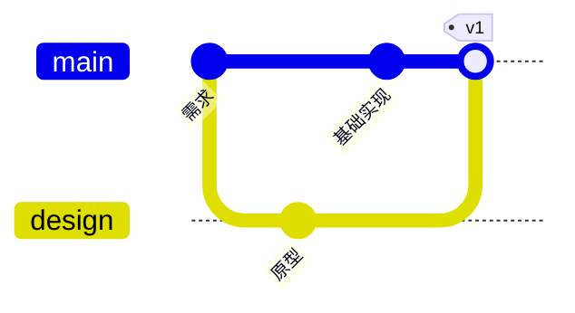

# Mermaid 节点与关系图

按图型读取对应小节。输入契约见 [Mermaid](mermaid.md)，共享呈现规则见 [Charts](charts.md)。本文件只规定各图型的语义、专用布局与交互；局部入场时长受Charts的批次预算约束。

## Flowchart 与 Architecture

Flowchart 按当前可用宽度比较作者主轴与另一主轴，选择可容纳或更窄的布局；两轴均超宽时保留可读尺寸和滚动。显式原生几何保留方向约束。分支居中，同组回流反向端口，跨组回流走外侧通道。

Architecture先保留原生二维方位，将中心点按24px容差聚类成行列，再按实际卡片尺寸重排；格位冲突、分组覆盖外组节点或布线失败时回退ELK。

- Accept `flowchart` / `graph` and `architecture-beta`. Keep the approved simple DAG and flat complete layered layouts. Complex topology uses ELKjs 0.10.0 (jsDelivr, then the same pinned version on unpkg on error or after a 15s loading timeout); architecture direction ports and explicit subgroup directions use Mermaid's native layout coordinates, then qv redraws every node and edge.
- Flowchart supports nested and partial groups, group endpoints, same-layer and cross-layer links, return paths, cycles and self-loops. Preserve LR/RL/TB/BT directions and explicit subgroup direction as resolved by Mermaid. Nested boundaries remain visible; flat architecture layers keep their quiet caption rules.
- Common shapes: rectangle, rounded rectangle, stadium, diamond, hexagon, circle/double circle, cylinder, subroutine, parallelogram, trapezoid and asymmetric node. Preserve point/open/circle/cross and two-ended markers, solid/dotted/thick edges, labels and invisible layout constraints.
- `architecture-beta` supports services, nested groups, junctions, T/B/L/R side ports, group endpoint modifiers and one-/two-ended arrows. Built-in cloud/database/disk/internet/server symbols map to Lucide. Custom external icon packs are not bundled.
- Prefer declared semantic icons for all architecture services. Built-in Mermaid symbols map deterministically to Lucide; explicit icons are not subject to the old all-or-none inference rule. Missing icons are reported by ID/name for correction. Legacy flowcharts without declarations retain auto/none. Never use decorative generic icons to fill gaps.
- Narrow widths scroll only the drawing horizontally; title and legend stay in place. Preserve readable node sizes and relationships. Loading uses the shared dot field until parsing, layout and first drawing are ready, with no fixed duration.
- Nodes normally use 48px height; shape/long-label nodes can grow. Top/title spacing remains 32px; legend padding is 16px above and below. Use thin neutral connections and integrated 5px markers. Same-role connections share ports; opposite roles separate on a shared side. Curves remain for the approved layouts; complex obstacle routing uses rounded bends.
- 入场按节点、线、箭头推进；局部时长按共享批次预算缩放。 Viewport re-entry replays; reduced motion disables animation. Optional tooltips remain near their nodes and avoid related nodes/lines, including group connections.
- Source-authored custom styles, rich labels, external icon packs beyond the supported host Lucide declarations, newer specialized flowchart shapes and other diagram types retain **native Mermaid output with a visible reason**. This is architecture topology coverage, not full custom styling for every Mermaid construct. Never silently discard unsupported syntax.

Keep labels concise and split very large diagrams into meaningful views. Never remove relationships merely to fit a diagram.

- 使用 Mermaid11.12 真实服务、汇接点、分组、方向与端口；不为视觉优化删除连接。服务240px宽、14px/20px完整换行，图标固定16px且向下偏移2px，对齐文本首行20px行盒的中心。
- 汇接点10×10px、零内边距，不继承分组卡片的浅灰底和12px/16px内距。保留实际汇接对象与源连线几何，避免空灰胶囊。
- mermaid-architecture-reader.js 以未缩放的主题tooltip呈现详情，靠近当前节点／分组，使用共享≤32px定位约束。正文12px/18px，名称14px/20px，次级标签#b8bdc6；浮层填充随主题变化，分段线与文字层级保持一致。
- 详情按名称／类型与ID／说明／所属路径／直接成员／直接连接分段。连接分列表示真实来源、方向、目标与端口，group修饰时保留原始服务端点。禁止将节点选择结果更新到图表下方；移除底部详情、提示和对象select。
- 悬浮／点击／键盘读取同一详情，节点高亮沿用原邻接关系；移入浮层保留，离开使用220ms缓冲。滚动停稳后恢复当前详情，Escape取消待恢复对象。展开仍fit整图，详情独立于场景缩放，返回保留滚动。
- 叶白、包含层从内向外muted18%灰／白交替，标题透明；明暗连线分别36%／48% muted-foreground混底。分组下钻原行为保留，原生不支持语法明确回退。

Flowchart pointer highlights wait until the pointer stops moving for 140ms; rapid node crossings preserve the previous highlight, and a 220ms exit grace period avoids an intervening neutral flash. Movement through diagram gaps preserves the old highlight until the pointer stops or leaves. External group entry cards use a name and arrow only; the click action is still named for assistive technology.

Flowchart leaf nodes use the host background. Container backgrounds alternate from inside outward: the direct leaf container uses opaque gray, the next container background, then gray again. The complete source hierarchy determines this level, including group cards and external portals.

Flowchart gray retains the original muted 18% mix over the host background, with an opaque background underneath to prevent stacked tints. Completed drawing stays visible while entry animation waits; short viewports must not leave large diagrams permanently hidden.

## State

`stateDiagram-v2` preserves source direction, initial/final symbols, choices, fork/join bars, plain state labels, loops, event/guard labels and composite-state parentage. Compound states initially remain fully visible. Clicking a compound header drills into its direct children; the 总览 breadcrumb returns to the complete view, where the breadcrumb bar is hidden. State diagrams have no group switch and keep the source vertical/horizontal layout without balanced folding. Group entry arrows sit immediately to the right of the title in one flex row. External relationships remain visible. Ordinary states do not drill down. Multiline state descriptions (`rectWithTitle`) are supported. Notes, concurrency regions and source custom styles/rich labels outside the supported shapes use visible native fallback, retaining source semantics.

The fixed parser adapter uses `db.getData()` semantic shapes and `parentId`; no inference from IDs or rendered geometry. Each parent scope starts layout/motion order from its actual initial state and follows source transitions. ELK model ordering keeps forward transitions readable; backward transitions and retry self-loops use distinct peripheral ports. Node cards use at least48px height,10px corners and host tokens; names and descriptions wrap after20 Unicode characters and render at14px/20px and12px/18px; start/end symbols use20px layout boxes, choice32px, fork/join64×6px. Connections use8px rounded bends and integrated5px arrows; labels remain8px beside their path with a transparent background; only the floating details use a popover surface.

Hover/focus highlights direct neighbors and transfers without hiding states. Transition details show a structured source → target row above a separated transfer explanation; state descriptions use a title and body. Text remains complete and source-derived. Tooltips avoid the trigger, labels and sampled wire segments; no pin. Nodes grow240ms, wires trace650ms, arrows reveal50ms, and labels reveal180ms with their transfer. Reduced motion and expansion are static; hover/resize do not replay. Expanded mode fits the entire scene. The viewport saves the last same-width inline scroll before resize can clamp it, then restores the position on return.

## ER

- Mermaid11.12 DB 是实体、别名、字段顺序、类型、PK/FK/UK、注释和关系基数的唯一来源。读取 getData 实际端点标记，避免 relSpec.cardA/cardB 的反向对应；getDirection 保留方向，字段名称不推导关系。custom style/class/rich label 明确原生回退。
- 实体白底14px圆角、标题14px/20px，技术ID另行显示；字段置于4%前景混色、8px圆角的内区。实体宽240–360px；key/type/name按实测分配，字段12px/18px换行，各行=max(30px,内容高度+12px)，不继承其他行高度。完整别名及长字段保留。
- 中性1.4px关系线和crow-foot标记使用明色#727a82／暗色#a3aab3，保留 identifying 实线与 non-identifying 虚线。每条关系独立端口，self loop 横向绕回；展开保持原几何。
- 标题突出实体邻域；字段只突出本行，有注释才显示详情；关系浮层分来源／目标／基数及关系说明，保持距触发文字≤32px，避免远距离避障。键盘自动滚动后恢复详情，Escape取消恢复。
- 卡片240ms、关系650ms、基数50ms；共享视口保留返回滚动，hover/resize 不重播，reduced/expanded静态。

## Class

- `classDiagram` preserves Mermaid 11.12 classes, labels, namespaces, stereotypes, visibility, generic types, attributes/methods, abstract/static classifiers and endpoint multiplicities from its actual DB. No relationship or member is inferred from names.
- Code-editor visual hierarchy uses white/theme-background14px-radius cards, transparent headers with14px foreground class titles and12px stereotypes, and separate neutral4% attribute/method panels with8px corners. Actual counts and12px/20px system-monospace signatures remain visible. Types are teal, methods blue, parameters/visibility muted, with separately calibrated light/dark colors. Preserve abstract italics and static underlines. Measure240–320px natural card widths; long names/signatures wrap into independently measured rows without truncation. Optional descriptions remain visible in the card; namespaces use dashed neutral borders and theme-background surfaces, with transparent title backgrounds. Wires render above namespaces and below cards.
- Equilateral hollow triangles distinguish inheritance/implementation by solid/dashed lines; equal-sided square diamonds preserve filled composition/hollow aggregation. Rounded open arrows preserve association/dependency. Stroke1.4px with theme-calibrated neutral colors, closed marks scaled uniformly for short terminal segments, exact rear joins and8px rounded orthogonal bends. Caption text wraps at180px and searches nearby path space avoiding cards, namespace titles and multiplicity labels.
- Hover highlights the actual card and current row, dimming unrelated cards/relationships.70ms hover settling and120ms leave buffering avoid flicker. Card/member hover has no popover. Only relationship text opens structured source → target details, with source multiplicities, UML kind and description; multiplicities themselves only select the relationship. Details anchor to the triggering text with12–28px candidate gaps and a32px maximum rectangle distance; local overlap is preferable to a distant empty position. Keyboard focus survives auto-scroll; Escape clears and cancels restoration. Inline drawing-only scrolling and whole-scene expanded fit preserve all content.
- 横向 Class 超过当前可用宽度时比较纵向布局，仅接受更窄结果；保留命名空间、成员与真实关系。
- Notes, lollipop interfaces, links/callbacks, rich HTML, custom styles and unrecognized endpoint symbols retain explicit native fallback. The shared qv viewport never attaches to fallback.

## Block

- 固定版本的root/children tree保留columns、span、explicit space、真实node/group/edge identity，不能把手动网格改为自动拓扑或解释面积为数量。space:N已展开成N个子项，每个占一列；源line callback观察后必须finally恢复。custom style/class、rich label、unsupported shape及跨行span溢出明确回退。
- model/layout/drawing分离；inline与expanded均保持160px cell、24px gap／nested padding，展开整体fit同一几何。节点至少48px，完整12px/18px标签按实测增长；组标题真实换行测高。叶节点底色，组由内向外灰／白交替，灰为muted18%混底，标题透明。
- 分组z0、连线z1、节点z2、标签z3，明暗中性线#727a82／#a3aab3，7px圆角折线与5pxmarker；原shape、solid/dotted/thick、circle/cross、self loop保持。透明命中和键盘按钮留在实际关系位置。
- 节点仅额外说明显示浮层，组显示成员，边显示真实两端；稳定hover为100ms停稳／160ms退出缓冲，近对象详情≤32px。移除预留底部详情区，避免为未打开的详情撑出空白；无筛选或虚构下钻。
-240ms节点、650ms实线／35ms stagger，箭头到达后出现；hover/resize不重播，reduced/expanded静态，完整退出20%重入可重播。

## C4

- Mermaid11.12拥有Context／Container／Component／Dynamic／Deployment源身份、类型、技术／说明、真实边界、外部状态与关系；保留声明顺序、row ceiling、Rel_Back/BiRel和原生Dynamic编号。观察创建回调后finally恢复。rich label、自定义style、sprite/tag/link和未知语义明确原生回退。
- model/layout/drawing分离；280px cell、72px gap、40px padding，外部参与者位于真实边界旁，组件按两列布局。源名称14px/20px、类型／技术／正文12px/18px，Lucide语义图标；叶白，包裹层由内向外muted18%灰／白，组名透明底完整换行。
- 连线及marker用明色#727a82／暗色#a3aab3，次级小字60%／68%前景混色。组z0、线z1、节点z2、标签z3；关系文字按最终DOM测量避让真实节点／组名／既有标签，没有合法标签位置的路由不能误报成功。
- 节点突出直接关系，组突出真实成员，边只突出两端与本边；带额外说明的节点、组、关系保留完整详情，定位距触发对象≤32px。取消远端停靠、隐藏详情区及其无效select，所有源节点仍可通过真实按钮键盘访问。100ms停稳／160ms退出缓冲，无筛选或虚构下钻。
-240ms节点、650ms线／35ms stagger，240ms标签，箭头到达后出现；resize/hover不重播，reduced/expanded静态。共享整体fit及返回滚动，宿主toolbar／clipboard／可见性恢复须另行验收。

## Mindmap

一级分支分配系列色并传递到子树；底色10%、边框45%、连线50%，按深度使用2/1.5/1px连线，中间层文字轻染分支色。

`mindmap` now uses the formal qv entrypoint. Read Mermaid11.12 `db.getMindmap()` once and retain every source topic, parent and ordering. Reuse the approved balanced bilateral tree: wrapped 12px names, 14px root, neutral branch cards, unboxed leaves, parent/descendant path emphasis, 240ms node / 650ms wire motion. Expanded mode shares the qv viewport; reduced motion is static. Custom icons/classes and rich labels explicitly fall back without a qv viewport. `descriptions` accepts Mermaid nodeId or numeric DB id; unknown IDs are errors. Shape decoration does not introduce quantitative semantics.

## Git

`gitGraph` 直接读取 Mermaid 11.12 的分支、提交顺序、父提交、合并、标签与方向。普通提交实心点，合并空心环，高亮方块，回滚叉，cherry-pick 虚线环；自动 ID 仅显示七位哈希，完整信息保留在可访问名称与 title。可容纳时横向泳道，否则纵向日志；hover/focus 高亮所属分支。富文本等未支持内容明确回退，不删除提交或连接。

