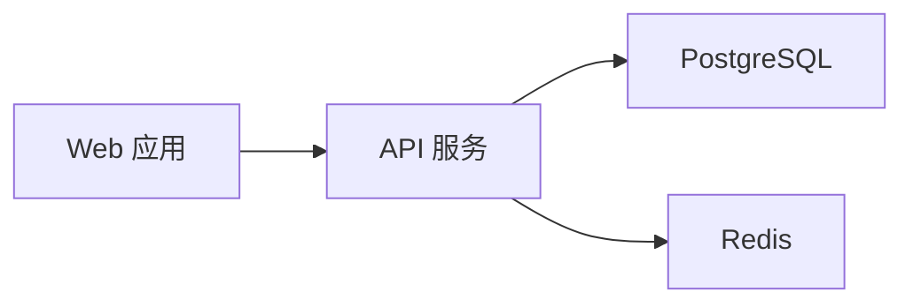
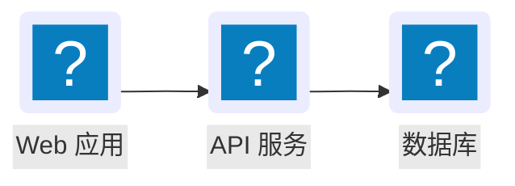
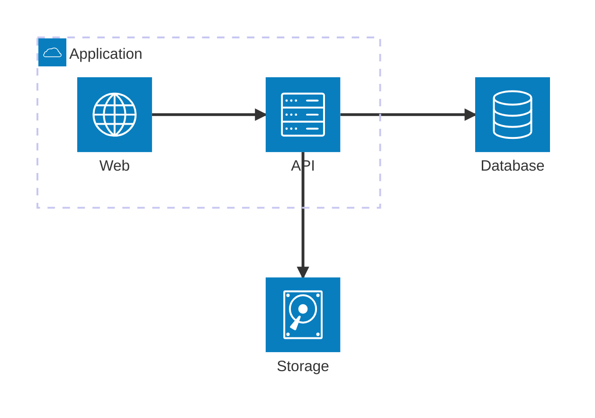

# Mermaid input, qv drawing

Write standard Mermaid source, not another node/edge JSON structure. qv parses it with Mermaid 11.12.0 and draws supported architecture, sequence, state, ER, class, timeline, journey, kanban, pie, XY, radar, Sankey, quadrant and block diagrams with its own layout, HTML nodes, Lucide icons and SVG curves. It does **not** display a restyled Mermaid SVG for enhanced diagrams. Requires jsDelivr access; no npm installation.

## Input

Prefer a UTF-8 `.mmd` file:



Run `python3 <skill-dir>/scripts/render.py mermaid <diagram.mmd> <output-directory>/<title>.html`.

All Mermaid references include `"mode":"wide"` to enable Codex's native expanded preview. Emit the runner's reference unchanged. Inline diagrams retain readable labels and drawing-only horizontal scrolling. The expanded preview fits the complete current diagram to its available width and height; exiting restores its inline scroll position. This shared presentation applies only to enhanced qv drawing. Native fallback, including unsupported sequence constructs, Gantt, unsupported class constructs and mindmap diagrams, retains its existing SVG sizing, styling and behavior; do not attach the qv viewport controller to fallback. Group browsing keeps the same scope in both modes; switch off “节点组” to view the complete architecture before copying. Native “Copy as image” captures the visible preview, so use it after expanding; this is not an independent full-resolution export.

Optional title and tooltip text use this envelope; the graph still comes entirely from Mermaid:

```json
{
  "title": "内容平台",
  "source": "flowchart LR\n  web[Web 应用] --> api[API 服务]\n  api --> db[PostgreSQL]\n  api --> cache[Redis]",
  "descriptions": {
    "api": "统一校验身份并处理业务请求。"
  }
}
```

`source`: required, at most 50,000 characters. `title`: optional, at most 200 characters. `descriptions`: optional plain text keyed by exact node or group ID, at most 2,000 characters each. Omit descriptions when labels suffice. `icons`: optional `"auto"` (default), `"required"` or `"none"`. Agent-authored architecture diagrams must declare semantic icons for all services, using native flowchart `lucide:` icon declarations (example below). Explicit source icons always survive; one missing service icon must produce an actionable error instead of hiding every icon. `required` also checks inferred flowchart icons. `none` applies only when source icons are absent. Junctions need no service icon. `legend`: optional labels such as `{"solid":"同步调用","dotted":"异步事件"}`, only when those meanings are known. When authoring a diagram, use solid edges by default. Introduce distinct line styles only for distinct relationship meanings, and always explain every used style with semantic legend labels or explicit edge labels. Never author mixed styles and silently omit their explanation. For supplied source with unclear meaning, resolve it from context or ask rather than guess. The renderer does not invent business semantics from line style. No permanent description panel; tooltips appear on hover or keyboard focus. Unknown description IDs are reported.

## Icons and group navigation

For Chinese labels, prefer standard flowchart icon syntax. qv resolves `lucide:` names against the host icon library and draws its approved inline icon/label nodes:



Declare semantic icons for **every service**; unknown Lucide names produce an actionable error. Built-in architecture symbols are also supported, but Mermaid 11.12.0 architecture labels have a restricted character grammar; use flowchart for Chinese labels:



The group hierarchy is the navigation hierarchy. `navigation` is optional: `auto` (default) and `drilldown` open grouped diagrams in group-browsing mode; `expanded` initially shows the full layout. The visible “节点组” switch allows either mode at runtime. Turning it off restores the original layered or nested-group layout and all source relationships. Do not create a second graph or coordinates for navigation.

An overview shows direct groups with previews of up to eight actual member nodes, nested subgroup labels and internal links; larger groups report the remaining count. Hover a member to highlight its real neighbors and corresponding group-level connections; click a group to enter it, then use the breadcrumb to return. External nodes preserve connections across the current boundary and can open their group. Only equivalent relationships are aggregated; the displayed count reports how many original connections they represent. Entering a group displays all direct nodes, subgroup previews and boundary connections together, including disconnected nodes. Ordinary service clicks never navigate or filter the graph. Wide local views may reflow top-down when port constraints allow; the full view retains original layers and groups. Ungrouped diagrams keep their prior expanded layout. Breadcrumbs alone provide return navigation; no redundant back button. Group entry chevrons sit at the right of the title row, with no “查看内部” footer. Aggregated counts use numeric circles at the actual wire midpoint; source-authored relationship labels stay intact.

## Architecture scope

- Accept `flowchart` / `graph` and `architecture-beta`. Keep the approved simple DAG and flat complete layered layouts. Complex topology uses ELKjs 0.10.0 (jsDelivr, then the same pinned version on unpkg on error or after a 15s loading timeout); architecture direction ports and explicit subgroup directions use Mermaid's native layout coordinates, then qv redraws every node and edge.
- Flowchart supports nested and partial groups, group endpoints, same-layer and cross-layer links, return paths, cycles and self-loops. Preserve LR/RL/TB/BT directions and explicit subgroup direction as resolved by Mermaid. Nested boundaries remain visible; flat architecture layers keep their quiet caption rules.
- Common shapes: rectangle, rounded rectangle, stadium, diamond, hexagon, circle/double circle, cylinder, subroutine, parallelogram, trapezoid and asymmetric node. Preserve point/open/circle/cross and two-ended markers, solid/dotted/thick edges, labels and invisible layout constraints.
- `architecture-beta` supports services, nested groups, junctions, T/B/L/R side ports, group endpoint modifiers and one-/two-ended arrows. Built-in cloud/database/disk/internet/server symbols map to Lucide. Custom external icon packs are not bundled.
- Prefer declared semantic icons for all architecture services. Built-in Mermaid symbols map deterministically to Lucide; explicit icons are not subject to the old all-or-none inference rule. Missing icons are reported by ID/name for correction. Legacy flowcharts without declarations retain auto/none. Never use decorative generic icons to fill gaps.
- Narrow widths scroll only the drawing horizontally; title and legend stay in place. Preserve readable node sizes and relationships. Loading uses the shared dot field until parsing, layout and first drawing are ready, with no fixed duration.
- Nodes normally use 48px height; shape/long-label nodes can grow. Top/title spacing remains 32px; legend padding is 16px above and below. Use thin neutral connections and integrated 5px markers. Same-role connections share ports; opposite roles separate on a shared side. Curves remain for the approved layouts; complex obstacle routing uses rounded bends.
- Entry grows nodes in 240ms, staggers spatial layers by 220ms, traces lines in 650ms and reveals arrowheads in 50ms. Viewport re-entry replays; reduced motion disables animation. Optional tooltips remain near their nodes and avoid related nodes/lines, including group connections.
- Source-authored custom styles, rich labels, external icon packs beyond the supported host Lucide declarations, newer specialized flowchart shapes and other diagram types retain **native Mermaid output with a visible reason**. This is architecture topology coverage, not full custom styling for every Mermaid construct. Never silently discard unsupported syntax.

Keep labels concise and split very large diagrams into meaningful views. Never remove relationships merely to fit a diagram.

## Sequence scope

`sequenceDiagram` preserves participant order, actor roles (host Lucide user icon), request/reply/async/open/cross/bidirectional arrows, self messages, autonumber start/step, activation, alt/else, loop, opt, par/and, critical/option and break. Note left/right/over retains its source position and reserves canvas space. Custom colored rects, participant boxes, rich labels, links/properties, explicit wrapping and unsupported participant types use visible native fallback instead of discarding semantics.

Neutral 48px participant cards and dashed lifelines share one intrinsic coordinate system with HTML message labels. Inline drawings retain readable 12px text and scroll horizontally; native expansion transforms the entire scene. Messages appear in order: 420ms masked trace, 140ms stagger, 180ms label reveal, then 60ms arrow reveal. Masking preserves reply dashes. Reduced motion and expansion show the complete static diagram; complete viewport exit/re-entry and visibility restoration may replay, but hover and resize do not.

Hover/focus highlights one message or a participant's related messages. Tooltips remain transient, track the current focus and avoid visible labels plus message lines/arrows; no pinned state or permanent panel. Escape, blur, pointer exit, scroll and display-mode changes clear details.

## State scope

`stateDiagram-v2` preserves source direction, initial/final symbols, choices, fork/join bars, plain state labels, loops, event/guard labels and composite-state parentage. Compound states remain fully visible; ordinary state clicks do not drill down. Notes, concurrency regions and source custom styles/rich labels outside the supported shapes use visible native fallback, retaining source semantics.

The fixed parser adapter uses `db.getData()` semantic shapes and `parentId`; no inference from IDs or rendered geometry. Each parent scope starts layout/motion order from its actual initial state and follows source transitions. ELK model ordering keeps forward transitions readable; backward transitions and retry self-loops use distinct peripheral ports. Node cards use48px height,10px corners and host tokens; start/end symbols use20px layout boxes, choice32px, fork/join64×6px. Connections use8px rounded bends and integrated5px arrows; labels remain8px beside their path instead of erasing it with a backplate.

Hover/focus highlights direct neighbors and transfers without hiding states. Tooltips avoid the trigger, labels and sampled wire segments; no pin. Nodes grow240ms, wires trace650ms, arrows reveal50ms, and labels reveal180ms with their transfer. Reduced motion and expansion are static; hover/resize do not replay. Expanded mode fits the entire scene. The viewport saves the last same-width inline scroll before resize can clamp it, then restores the position on return.

## Validation and maintenance

The runner checks the envelope and generated fragment. It reports `runtime: pending-browser`; Mermaid syntax is checked at runtime. `data-state` becomes `enhanced`, `native` or `error`; `data-renderer="qv-architecture"` identifies genuine qv drawing.

`assets/mermaid-model.js` and the separate sequence/state/ER/class/timeline/journey/kanban/pie/XY/radar/Sankey/quadrant/block model adapters isolate version-specific parser access. Mermaid's public `parse()` only identifies/validates the diagram; it does not return a general AST. The pinned adapter therefore uses `mermaidAPI.getDiagramFromText()` and flowchart/architecture/sequence/state/ER/class/timeline/journey/kanban/pie/XY/radar/Sankey DB accessors and original quadrant/block parser callbacks. These are internal/version-sensitive interfaces: never upgrade Mermaid without rerunning parser fixtures and visual comparison against the approved design. Do not replace this adapter with regex parsing or reconstruct edge identity from SVG geometry.

`assets/mermaid-viewport.js` owns enhanced qv inline/expanded presentation; `assets/mermaid-layout.js` owns complex geometry; `assets/mermaid.html` owns architecture marks, interaction and motion; `assets/mermaid-sequence.js` owns sequence drawing and uses the same viewport controller. `assets/mermaid-state.js` owns state marks and interaction and shares the layout engine and viewport. Native `render()` may be measured offscreen for direction-constrained layout; enhanced output still contains only qv marks. Visible native SVG is reserved for explicit fallback. Validation must cover appearance, shared ports, marker joins, tooltip proximity and actual animation—not only element counts. See `tests/mermaid-browser.md`.

Navigation transitions differ from initial entry: use a 360ms origin-aware spatial transition, followed by a 380ms wire trace. Shared nodes transition from their current rendered position. Keyboard navigation and reduced motion skip these transitions. Drilldown simplifies group nesting only; do not add per-node exploration steps.

## ER entities and relationships

`erDiagram` is adapted from Mermaid11.12 DB, including aliases, all attribute types/names, PK/FK/UK combinations and comments, four end cardinalities, solid identifying versus dashed non-identifying relationships, directions, isolated entities and self relationships. Keys do not infer connections. Source custom styles/classes or rich text retain a visible native fallback.

`mermaid-er-model.js` isolates the ER DB contract: actual `getData()` endpoint marker names avoid the reversed `relSpec.cardA/cardB` endpoint association; actual `getDirection()` is used. `mermaid-er.js` independently draws full entity field containers, neutral crow-foot markers and relation labels. Header details highlight the neighborhood; field details highlight only the field; relation details highlight only that relation and both ends. Comments stay accessible by hover/focus.

Use the shared viewport for inline horizontal scrolling and whole-scene expanded fit. Per-relationship ports and lateral self loops separate cardinality markers. Details avoid full cards, not only headers. Restore keyboard details after automatic focus scrolling, while Escape cancels restoration. Same-width expansion reads the current scroll immediately; resizing before expansion uses the saved inline-width position. Original fallback SVG and its behavior are untouched.

## Class scope

- `classDiagram` preserves Mermaid 11.12 classes, labels, namespaces, stereotypes, visibility, generic types, attributes/methods, abstract/static classifiers and endpoint multiplicities from its actual DB. No relationship or member is inferred from names.
- Class containers follow qv 10px radius, 48px header (64px with annotation), 12px members and 30px rows. Attributes and methods remain separate; full signatures determine width and are not truncated. Namespaces show all contents without navigation.
- Hollow triangles distinguish inheritance/implementation through solid/dashed lines; filled/hollow diamonds preserve composition/aggregation. Ordinary association/dependency arrows retain their line style. Self relationships reserve an outer reading channel with labels separated from multiplicities.
- Member hover/focus emphasizes only that row; class titles highlight the neighborhood; relation labels/multiplicities highlight only their actual relationship. Transient details prefer nearby free space and never intercept the pointer. Inline keeps readable text with drawing-only scrolling; expanded fits the complete diagram and restores inline position on return.
- Notes, lollipop interfaces, links/callbacks, rich HTML, custom styles and unrecognized endpoint symbols retain explicit native fallback. The shared qv viewport never attaches to fallback.

## Timeline scope

- `timeline` keeps Mermaid11.12 source order, section membership, arbitrary text periods, repeated period names, multiple events and periods without events. Read `getTasks` once and copy immediately: that internal DB appends to a shared array. Do not reparse to extract a second graph, sort guessed dates or infer elapsed durations.
- Inline is a neutral horizontal chronology:216px period columns,40px gaps,14px complete event text,12px period and section labels. Long period labels share a measured header height so the axis never crosses text. Continuous section captions stay within their own span during horizontal scrolling. No decorative palette or causality arrow.
- Complete desktop view uses184px columns,24px gaps and14px period/section text; full events wrap, then the shared viewport fits the complete drawing. Returning first restores intrinsic inline geometry, then the shared saved scroll position. Narrow inline preserves readable text and drawing-only horizontal scrolling.
- Period details show source section/period or supplied descriptions; events remain visible and are not redundantly listed in period tips. Event details are local. Safe positions consider all visible text and include the space below the tallest event column; Escape and scrolling clear transient state. Unknown description IDs are errors; IDs are actual parsed task IDs.
- Axis traces through the source sequence, points grow at fixed coordinates with matching short stems, and period/event columns enter by order. Full exit/reentry replays, ordinary hover/resize does not; reduced and expanded remain static. Rich HTML falls back visibly to native Mermaid without a qv viewport.


## Journey scope

- `journey` preserves Mermaid11.12 source task order, contiguous sections, raw scores1–5 and actual people/actor participation. Steps without a section, repeated task names and tasks without actors remain visible. No elapsed time, aggregate rating, causality or participation strength is inferred. Read `getTasks` once and copy before any subsequent parsing because it appends to shared DB storage; read the actual `getActors` order. Journey has no DB task ID: `descriptions` uses stable source-order IDs `step-1`, `step-2`, etc.; unknown IDs are errors.
- One experience curve sits above the actor participation matrix, aligned to the same step columns. Single series1 score line, raw value labels and neutral participation dots use host colors. Preserve full text through wrapping. The score domain stays1–5, not a domain guessed from observed values.
- Inline reserves128px for the score axis and actual actor names, so horizontal reading retains its references. Step columns are at most168px with24px gaps and adapt to the available drawing width. Continuous section captions stay inside their own source span and follow the visible region. Expanded mode reintegrates the reference column into the complete scene, uses144px step columns/16px gaps and the shared fit. Return restores inline geometry and the shared saved position. No custom full-screen overlay.
- Steps/scores highlight their exact participation; an actor highlights all its real participating steps; a matrix point highlights its actual step/actor. No drilldown, hidden steps or invented connections. Step details supplement the already visible name/section with score and full actors; score and participation details retain the complete task identity, and actor details show its complete name plus actual participation count. Avoid redundant lists of visible tasks. Transient details fit narrow drawing space and prefer nearby free positions that avoid headings, score/role references, marks and the actual curve. Wheel clears hover; keyboard details restore at the settled scroll position; Escape cancels them.
- Curve traces1200ms; fixed-center dots grow240ms in source order, values follow100ms and participation points appear with their step. Step labels enter300ms with8px translation. Full exit/reentry/visibility restoration replays, ordinary hover/resize does not; reduced/expanded are static. Unsupported rich HTML and scores outside1–5 visibly fall back to Mermaid without the qv viewport.
- `mermaid-journey-model.js` owns this version-sensitive DB access; `mermaid-journey.js` draws the independently designed view and shares the viewport controller. Do not upgrade Mermaid or replace DB access with regex parsing without comparing parser fixtures and actual rendered semantics.

## Kanban scope

- `kanban` preserves Mermaid11.12 actual column/task IDs, source order, column membership and assigned/ticket/priority fields. Keep empty columns and metadata-free tasks. Counts describe current cards, not workload, completion ratios or elapsed time. Use `getData`/`getSections`; do not author a second graph.
- Independent neutral HTML cards preserve complete text. Inline columns232px/gap24px scroll horizontally; expanded columns204px/gap20px share whole-scene fit. Common measured headings align columns, and return restores inline geometry and saved position. No custom full-screen overlay.
- Ordinary tasks highlight locally and show a transient phase detail; complete task text and metadata stay on the card and in its accessible label. Optional descriptions remain complete. Details prefer nearby free space avoiding actual text/headings. Tab brings the whole task into the drawing viewport; wheel clears details and keyboard restoration waits for settled scrolling; Escape cancels delayed restoration. No drag/edit/navigation or filtering.
- Headers300ms/8px, cards240ms/8px by source column/row. Exit/reentry/visibility restores entry; resize does not replay; reduced and expanded remain static. Rich HTML/icons and ticketBaseUrl preserve native semantics without qv viewport behavior.
- `mermaid-kanban-model.js` owns version-sensitive DB access; `mermaid-kanban.js` draws the independent view. Keep Mermaid11.12 pinned and rerun parser/visual checks before changes.

## Pie scope

- `pie` reads Mermaid11.12 getSections Map in actual source order; preserve raw weights, actual distinct labels and showData. Keep zero-valued categories in the list. Positive finite total required; unsupported rich labels and zero total remain native. Optional descriptions use actual category labels as keys, and unknown keys are errors.
- qv independently draws exact proportional sectors without collapsing tiny shares or inventing units. Host category colors pair with full names and percentages. showData additionally exposes raw values on the list; raw values stay in accessible labels/details otherwise. At narrow widths the complete list stacks below the circle. Shared expanded mode fits the whole scene; no extra fullscreen layer.
- Real slice hover and button focus/click provide local emphasis with one transient near-trigger detail. Full label/value/share/description are accessible. Avoid readable labels, values and title; no competing native title. No filter, editing or pinned detail.
-1050ms common clockwise reveal clips the complete unchanged sectors. Category readouts appear by cumulative share; resize returns complete static content without replay. Expanded/reduced remain static; complete exit/reentry and visibility restoration replay. `mermaid-pie-model.js` isolates the version-sensitive API and `mermaid-pie.js` owns drawing/interaction.

## XY scope

- `xychart-beta` preserves Mermaid11.12 actual point coordinates, category order, numeric x/y domains, orientation and bar/line source order. `getXYChartData` and `getChartConfig` are isolated in mermaid-xy-model.js. Do not reconstruct values from SVG or regex. Pinned11.12 has no named series contract; source type/index labels such as柱形1/折线1 identify plots without invented business names.
- Independent qv drawing uses proportional bars from actual zero, lines through true coordinates, complete category labels/axis titles and a centered wrapping legend. Inline retains readable category slots with drawing-only scroll and fixed value reference/caption. Expanded fits the whole scene and return restores saved inline position; no custom fullscreen layer.
- Category hover/pointer, focus and click show exact values from every corresponding source series. One transient near-trigger detail avoids visible labels/values/title/reference/legend and stays inside real frame bounds. Focus brings the whole category label into view; settled scroll restores keyboard detail; Escape cancels it.
- Bars grow650ms simultaneously from zero; lines trace1200ms. Complete exit/reentry/visibility restoration replay; hidden cancels motion and detail. Hover/resize do not replay; reduced/expanded are static. Rich axis HTML and additional descriptions visibly preserve native semantics.


## Radar scope

- `radar-beta` reads ordered axes, normalized positional/keyed curves, names, min/max, ticks, graticule shape and showLegend directly from Mermaid11.12 DB. `mermaid-radar-model.js` isolates this internal contract. The auto maximum comes from actual curve values; non-zero minima are retained. Rich labels, extra descriptions and out-of-range/degenerate domains visibly preserve native semantics without a qv viewport.
- Independent qv drawing follows the existing radar language: thin neutral grid, complete12px labels,1.7px outlines/.035 fill, stable series tokens and circle/square/diamond with corresponding solid/dashed/dotted identification. Radial distance encodes score, not polygon area. Wider labels/outer separation accommodate long dimensions; intrinsic inline geometry initially centers and scrolls, full view fits all content and restores the saved inline position.
- Axis label focus/click and tolerant axis/point hits compare all source series for that dimension. A series key reads its complete profile. Focus scrolls the full label into view and restores details after scrolling. Details must avoid the heading, source, dimensions, series keys and scale labels completely; use a nearby free position, or a transient natural-flow detail below the chart when none fits. Keep actual values and complete names. Escape closes mouse SVG and keyboard button details alike.
- Vertices expand radially900ms with quartic easing; stroke/marker sizes remain constant. Resize, reduced motion and expanded entry remain static; complete exit then20% reentry replays. Hidden cancels motion; actual hidden/restoration remains an explicitly unverified host boundary. No persistent filters, edit controls or custom full-screen overlay.

## Sankey scope

- `sankey-beta` reads actual Mermaid11.12 graph/config through mermaid-sankey-model.js. Preserve source IDs/order, repeated edges, positive finite quantities, nodeAlignment, source/target/gradient linkColor, showValues and value prefix/suffix. Optional descriptions use actual node IDs. No regex CSV parser or graph authored twice. Pinned11.12 grammar does not accept Chinese labels or entity encodings; valid ASCII labels work with quoted commas and doubled quotes. Do not upgrade or rewrite the parser to hide this limitation.
- Independent qv drawing uses d3-sankey0.12.3 for DAG positions. Band width and node height encode actual quantities with one common scale, including fractional subpixel links. A separate transparent path improves hit tolerance without inflating visible flow. Node values follow max(inflow,outflow); details separately label actual inflow/outflow. Multi-stage aggregate edges do not identify individual paths or establish source-to-final attribution.
- Complete14px labels and12px values fit measured top/bottom/node gaps. Inline retains intrinsic columns and horizontal drawing scroll, with a conditional cue. Expanded tightens columns and shares the native whole-scene fit; return restores original width and scroll. Neither mode drops nodes, values or edges.
- Node hover/click/focus highlights direct incident flows; a flow identifies its exact source/target/raw quantity and shares of source outgoing and target incoming. Invisible native flow buttons sit on the actual bands and reveal their raw value on keyboard focus, with complete accessible names and automatic horizontal scrolling. No permanent repeated edge list, filtering or pin state. One transient detail uses real trigger bounds and text obstacles; Escape and settled scroll clear it.
-1000ms quartic-out horizontal clipping reveals fixed complete bands without changing proportions. Reduced/expanded/resize stay complete; complete exit then20% reentry replays. Actual document-hidden restoration and daily Codex manual acceptance remain separate verification boundaries.
- Zero/nonpositive values, cycles, rich labels and literal custom link colors visibly retain native rendering. Native fallback receives no qv viewport controller and preserves its previous display behavior.

## Quadrant scope

- `quadrantChart` preserves source-order points, complete names, exact normalized 0–1 coordinates, axis ends, four source quadrant captions and title. Q1 is upper-right, Q2 upper-left, Q3 lower-left and Q4 lower-right. A coordinate exactly .5 is reported as a boundary, not assigned an invented equality rule. Chinese labels use the native quoted-string syntax. Optional descriptions use source-order `point-1`, `point-2`, etc.; unknown IDs are errors.
- Pinned11.12 exposes only built pixel data. The separate model records original DB parser callback arguments while the full Mermaid preprocessing/parser runs, then restores every method in `finally`, including failures. Never derive normalized values from an SVG or author a second point dataset. Point classes, custom styles and rich labels retain visible native fallback.
- Independent qv drawing keeps neutral frame/cross/ticks at0/.5/1 and single series1 fixed-coordinate points. Complete12px labels choose nearby free positions with4px clearance and leader lines; labels may move, true coordinates may not. A single nearest-point hit mechanism prevents overlapping hit circles selecting unrelated points. Coincident coordinates identify every source entity together; each source label remains individually keyboard-accessible.
- Inline keeps readable intrinsic geometry and horizontal drawing scroll. Shared native expanded preview fits the whole scene, then restores the previous inline scroll. Narrow views have a stable transient-detail reading region measured from the complete source content, with full axis semantics, raw values, complete entity names and quadrant/boundary. A clear full-view cue distinguishes overview from individual reading and return to original-size horizontal reading. Wide views use compact nearby floating details with X/Y coordinates on one line and retain complete axis labels on the drawing. No persistent entity list, filters or custom fullscreen overlay.
- Fixed-position point growth240ms, label300ms/4px with80ms source-order stagger. Delayed marks use backwards fill to prevent pre-entry flashes. Resize/reduced/expanded remain static; complete exit then20% reentry may replay. Real document-hidden restoration and daily Codex native buttons remain separate host acceptance boundaries. Native fallback never attaches the qv viewport.


## Block scope

- `block-beta` reads the pinned Mermaid root/children tree, actual node IDs, source labels, group labels, column settings, spans, explicit spaces and connections. Preserve the manual grid rather than substitute automatic topology. Mermaid expands `space:N` into N children: each expanded child occupies one column. Optional descriptions use actual leaf/group IDs; unknown IDs are errors.
- The original `edgeStrToEdgeData` callback records already-parsed line tokens while the complete Mermaid parser runs, then restores the method in `finally` on success or failure. Solid/dotted lines, labeled thick lines, circle/cross endpoints and self loops retain source identity. Validate legal syntax with the pinned parser; do not assume another diagram's edge syntax is accepted. Custom style/class, rich HTML, unsupported shapes and cross-row span overflow visibly retain native output without a qv viewport.
- Separate model/layout/drawing files keep layout semantic and styling independent. Intrinsic cells160px inline /128px expanded, gaps24/20px, nested padding24px. Source rows and columns stay exact; measured12px/18px complete names determine height. Normal nodes48px minimum, one1px neutral outline,10px corners; shaped nodes grow as required. A cylinder uses one closed theme-aware body and an unfilled internal arc. Orthogonal obstacle routes avoid node bodies and group captions, with7px rounded bends and5px arrowheads.
- Nodes show actual incoming/outgoing relationships; groups show complete descendant members. Every visible relation has an accessible native button at its actual route, even when it has no source label. Relation focus highlights only its two source endpoints and that relation. No filtering, invented weights or drilldown.
- Inline keeps readable intrinsic text and horizontal drawing scroll with a conditional cue. Expanded tightens cells and fits the whole scene through the shared viewport. Restore intrinsic layout before reapplying saved inline scroll. Narrow and expanded modes reserve source-derived detail height below the drawing, keeping complete names, membership and relations at unscaled12px. Wide inline details use nearby free space and avoid actual nodes/captions/labels. The detail is transient, themed,12px-radius and12px×14px padding; Escape clears it.
- Source-order nodes240ms/4px; solid lines trace650ms with35ms edge stagger, and target markers appear after their line reaches the destination. Complete exit then20% reentry may replay. Reduced/expanded/resize finish static; timers and animations are canceled together and actual completion sets the final state. Real document-hidden restoration and daily Codex native controls remain host verification boundaries.

## C4 scope

- Read actual Context/Container/Component/Dynamic/Deployment data from Mermaid11.12.0. Preserve typed nodes, source names, technologies/descriptions, real boundary containment, external status and relation protocols. Temporarily observe the parser's own creation callbacks to retain source order and optional-feature presence, then restore every callback in finally. Rel_Back reverses logical endpoints; BiRel retains both arrowheads; Dynamic numbers follow native declaration order rather than ignored RelIndex author numbers.
- Model, layout and drawing stay separate. Intrinsic200px cells/40px gap/32px padding, external participants beside real boundaries, and two-column container components reduce unnecessary width without inventing groups or changing topology. Per-kind declaration order and UpdateLayoutConfig row ceilings are retained. Complete names14px/20px weight500; type/technology/description/protocol12px/18px. Semantic Lucide icons and neutral1px outlines match the shared language.
- Route candidates are evaluated after final compaction against actual DOM label sizes. Labels cannot intersect nodes, boundary captions or earlier labels. Reject candidates without zero-overlap positions. Node/group/edge native buttons expose full source details; edges emphasize exactly their endpoints and wire. Details avoid all readable marks or dock below the diagram, with source-derived stable height and unscaled12px text. Narrow expanded mode adds one native node selector for easy complete-name lookup; it opens the same detail and does not filter the graph.
- Shared whole-scene fit and saved inline scroll handle mode changes. Nodes240ms/4px, solid paths650ms with35ms edge stagger, labels240ms; markers appear after arrival. Full exit followed by20% reentry can replay. Reduced/expanded/resize show final static geometry and cancel timers/animations together.
- Rich labels, explicit element/relation styles, sprites/tags/links, unknown node/relation semantics and unsupported endpoints visibly retain native output. No qv viewport attaches to native fallback. C4 is an experimental Mermaid family; pinned-parser behavior and actual host toolbar/clipboard/document-hidden acceptance remain separate boundaries.


## Architecture-beta reading

- Preserve full Mermaid service/group names. Service cards are 240px wide with wrapped 14px/20px names; calculate height from the actual 184px content width and 500 weight. Junctions remain actual source objects, not inferred data stores.
- Full group captions are keyboard-accessible reading buttons. Ordinary service click reads identity and relations without drilling down; the existing group-only switch and group-card navigation keep their original behavior.
- `mermaid-architecture-reader.js` provides an unscaled 12px/18px detail region below the drawing. It includes source name, type/ID, optional description, real parent path, direct connections and original T/B/L/R ports/arrowheads. Group details list direct members; group-modified edges also retain original donor service IDs.
- At 320px and in expanded mode, a native select lists every original service, junction and group. Selection reads the model without filtering it. Detail height is measured and reserved; keyboard focus scrolls the whole card into view, restores detail after scroll settles, and Escape cancels pending restoration.
- Expanded preview fits the complete geometry; inline return restores scroll. Source custom constructs continue to use the earlier native fallback before any viewport or reader is initialized. Mermaid11.12 architecture labels have restricted grammar: use valid ASCII source labels, with optional Chinese description, or Chinese flowchart labels.
