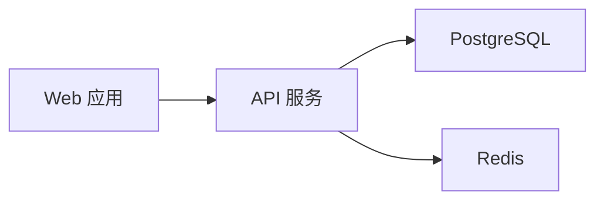
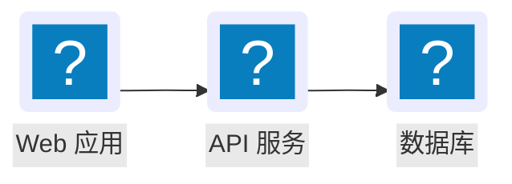
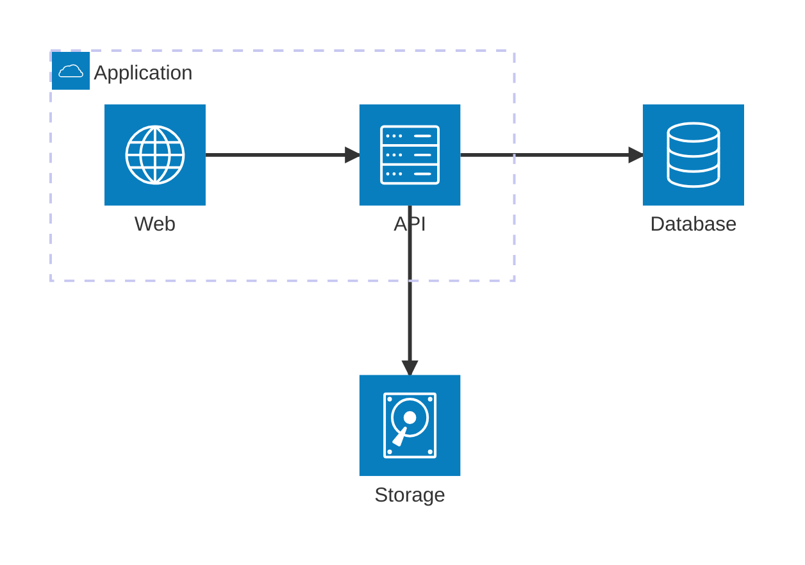

# Mermaid input, qv drawing

Write standard Mermaid source, not another node/edge JSON structure. qv parses it with Mermaid 11.12.0 and draws supported architecture, sequence, state, ER, class, timeline, journey, kanban, pie, XY, radar, Sankey, quadrant, block, mindmap and Gantt diagrams with its own layout, HTML nodes, Lucide icons and SVG curves. It does **not** display a restyled Mermaid SVG for enhanced diagrams. Requires jsDelivr access; no npm installation.

## Input

Prefer a UTF-8 `.mmd` file:



Run `python3 <skill-dir>/scripts/render.py mermaid <diagram.mmd> <output-directory>/<title>.html`.

All Mermaid references include `"mode":"wide"` to enable Codex's native expanded preview. Emit the runner's reference unchanged. Inline diagrams retain readable labels and drawing-only horizontal scrolling. The expanded preview fits the complete current diagram to its available width and height; exiting restores its inline scroll position. This shared presentation applies only to enhanced qv drawing. Native fallback, including unsupported sequence constructs, unsupported Gantt constructs, unsupported class constructs and unsupported mindmap constructs, retains its existing SVG sizing, styling and behavior; do not attach the qv viewport controller to fallback. Group browsing keeps the same scope in both modes; switch off “节点组” to view the complete architecture before copying. Native “Copy as image” captures the visible preview, so use it after expanding; this is not an independent full-resolution export.

Optional title and tooltip text use this envelope; the graph still comes entirely from Mermaid:

```json
{
  "title": "内容平台",
  "source": "flowchart LR\n  web[Web 应用] --> api[API 服务]\n  api --> db[PostgreSQL]\n  api --> cache[Redis]",
  "descriptions": {
    "api": "统一校验身份并处理业务请求。"
  }
}
```

`source`: required, at most 50,000 characters. `title`: optional, at most 200 characters. `descriptions`: optional plain text keyed by exact node or group ID, at most 2,000 characters each. Omit descriptions when labels suffice. `icons`: optional `"auto"` (default), `"required"` or `"none"`. Agent-authored architecture diagrams must declare semantic icons for all services, using native flowchart `lucide:` icon declarations (example below). Explicit source icons always survive; one missing service icon must produce an actionable error instead of hiding every icon. `required` also checks inferred flowchart icons. `none` applies only when source icons are absent. Junctions need no service icon. `legend`: optional labels such as `{"solid":"同步调用","dotted":"异步事件"}`, only when those meanings are known. When authoring a diagram, use solid edges by default. Introduce distinct line styles only for distinct relationship meanings, and always explain every used style with semantic legend labels or explicit edge labels. Never author mixed styles and silently omit their explanation. For supplied source with unclear meaning, resolve it from context or ask rather than guess. The renderer does not invent business semantics from line style. No permanent description panel; tooltips appear on hover or keyboard focus. Unknown description IDs are reported.

Flowchart labels remain centered and on one line until measured text exceeds 228px minus icon space. Longer labels wrap and nodes grow to fit; diamonds and circles widen around their central text area. Large elongated complete diagrams (at least 16 nodes, long dimension above 2400px, aspect ratio above 3:1 in either direction) fold into alternating rows or columns inside their existing groups, aiming toward a square overview. Source LR/RL/TB/BT determines the initial reading direction; all node IDs, groups, edges and arrow semantics remain intact. This also applies when returning from group browsing to the complete view. Dark-mode flowchart wires and arrowheads have a slightly stronger contrast; light mode retains its previous colors.

## 节点图表的共同设计思考

生成和审视流程图、状态图与架构图时，主动复用已确认的原则：短文本居中且超过阈值才换行，按真实字体测量容器；普通图保留阅读方向，规模、长边与长宽比同时超限才平衡布局；叶节点为主题背景，包含层从内向外浅灰/背景交替（浅灰为18% muted与背景混色）；复杂容器支持下钻并保留跨边界关系和路径，同层切换不出现在总览；悬浮切换保持稳定，不重播进场动画；暗色单独增强必要对比，不加深浅色灰面。独立内容行不继承最高行高度，浮层只补充不可见信息并避开图中内容。浮层存在实体关系与正文层次时，直接用真实模型字段分别呈现关系、标题和说明，不拼成一段长文本，也不从说明文案猜关系。保留各类型的形状、端点和业务语义，不把共性理解为强制同一布局。完整规则见项目 `DESIGN.md` 的“节点图表的共同设计原则”。

## Icons and group navigation

For Chinese labels, prefer standard flowchart icon syntax. qv resolves `lucide:` names against the host icon library and draws its approved inline icon/label nodes:



Declare semantic icons for **every service**; unknown Lucide names produce an actionable error. Built-in architecture symbols are also supported, but Mermaid 11.12.0 architecture labels have a restricted character grammar; use flowchart for Chinese labels:



The group hierarchy is the navigation hierarchy. `navigation` is optional: `auto` (default) and `drilldown` open grouped diagrams in group-browsing mode; `expanded` initially shows the full layout. The visible “节点组” switch allows either mode at runtime. Turning it off restores the original layered or nested-group layout and all source relationships. Do not create a second graph or coordinates for navigation.

An overview shows direct groups with previews of up to eight actual member nodes, nested subgroup labels and internal links; larger groups report the remaining count. Hover a member to highlight its real neighbors and corresponding group-level connections; click a group to enter it, then use the breadcrumb to return. External nodes preserve connections across the current boundary and can open their group. Only equivalent relationships are aggregated; the displayed count reports how many original connections they represent. Entering a group displays all direct nodes, subgroup previews and boundary connections together, including disconnected nodes. Ordinary service clicks never navigate or filter the graph. Wide local views may reflow top-down when port constraints allow; the full view retains original layers and groups. Ungrouped diagrams keep their prior expanded layout. Breadcrumbs alone provide return navigation; no redundant back button. Group entry chevrons sit at the right of the title row, with no “查看内部” footer. Aggregated counts use numeric circles at the actual wire midpoint; source-authored relationship labels stay intact.

## Architecture scope

- Accept `flowchart` / `graph` and `architecture-beta`. Keep the approved simple DAG and flat complete layered layouts. Complex topology uses ELKjs 0.10.0 (jsDelivr, then the same pinned version on unpkg on error or after a 15s loading timeout); architecture direction ports and explicit subgroup directions use Mermaid's native layout coordinates, then qv redraws every node and edge.
- Flowchart supports nested and partial groups, group endpoints, same-layer and cross-layer links, return paths, cycles and self-loops. Preserve LR/RL/TB/BT directions and explicit subgroup direction as resolved by Mermaid. Nested boundaries remain visible; flat architecture layers keep their quiet caption rules.
- Common shapes: rectangle, rounded rectangle, stadium, diamond, hexagon, circle/double circle, cylinder, subroutine, parallelogram, trapezoid and asymmetric node. Preserve point/open/circle/cross and two-ended markers, solid/dotted/thick edges, labels and invisible layout constraints.
- `architecture-beta` supports services, nested groups, junctions, T/B/L/R side ports, group endpoint modifiers and one-/two-ended arrows. Built-in cloud/database/disk/internet/server symbols map to Lucide. Custom external icon packs are not bundled.
- Prefer declared semantic icons for all architecture services. Built-in Mermaid symbols map deterministically to Lucide; explicit icons are not subject to the old all-or-none inference rule. Missing icons are reported by ID/name for correction. Legacy flowcharts without declarations retain auto/none. Never use decorative generic icons to fill gaps.
- Narrow widths scroll only the drawing horizontally; title and legend stay in place. Preserve readable node sizes and relationships. Loading uses the shared dot field until parsing, layout and first drawing are ready, with no fixed duration.
- Nodes normally use 48px height; shape/long-label nodes can grow. Top/title spacing remains 32px; legend padding is 16px above and below. Use thin neutral connections and integrated 5px markers. Same-role connections share ports; opposite roles separate on a shared side. Curves remain for the approved layouts; complex obstacle routing uses rounded bends.
- Entry grows nodes in 240ms, staggers spatial layers by 220ms, traces lines in 650ms and reveals arrowheads in 50ms. Viewport re-entry replays; reduced motion disables animation. Optional tooltips remain near their nodes and avoid related nodes/lines, including group connections.
- Source-authored custom styles, rich labels, external icon packs beyond the supported host Lucide declarations, newer specialized flowchart shapes and other diagram types retain **native Mermaid output with a visible reason**. This is architecture topology coverage, not full custom styling for every Mermaid construct. Never silently discard unsupported syntax.

Keep labels concise and split very large diagrams into meaningful views. Never remove relationships merely to fit a diagram.

## Sequence scope

- 保留 Mermaid11.12 的参与者顺序、角色、消息方向、虚实线和箭头类型、自动编号、激活条、self message、alt/loop/par/critical 等控制框及 note 的源位置；未支持的 box、rich label、properties 等明确原生回退。
- 参与者标题按实际 DOM 换行测高，内容宽最多240px；消息最多288px并完整换行。每条消息按自己的高度预留空间，长文本不会覆盖前一条消息或将后续消息统一撑高。共享 intrinsic scene，展开整体 fit，返回保留滚动。
- 消息线与箭头使用明色#727a82／暗色#a3aab3，lifeline 更轻；次级小字使用60%／68%前景混色。参与者悬浮突出真实邻接消息；消息浮层分列表示来源、目标，再显示完整正文，距离触发对象不超过32px。不重复展示没有额外说明的参与者标题。
- 消息420ms依次描画，stagger=min(140ms,900ms/(条数−1))，180ms标签和60ms箭头随线到达。减少动态和展开静态；悬浮、resize 不重播，完整退出后重入可重播。

## State scope

`stateDiagram-v2` preserves source direction, initial/final symbols, choices, fork/join bars, plain state labels, loops, event/guard labels and composite-state parentage. Compound states initially remain fully visible. Clicking a compound header drills into its direct children; the 总览 breadcrumb returns to the complete view, where the breadcrumb bar is hidden. State diagrams have no group switch and keep the source vertical/horizontal layout without balanced folding. Group entry arrows sit immediately to the right of the title in one flex row. External relationships remain visible. Ordinary states do not drill down. Multiline state descriptions (`rectWithTitle`) are supported. Notes, concurrency regions and source custom styles/rich labels outside the supported shapes use visible native fallback, retaining source semantics.

The fixed parser adapter uses `db.getData()` semantic shapes and `parentId`; no inference from IDs or rendered geometry. Each parent scope starts layout/motion order from its actual initial state and follows source transitions. ELK model ordering keeps forward transitions readable; backward transitions and retry self-loops use distinct peripheral ports. Node cards use at least48px height,10px corners and host tokens; names and descriptions wrap after20 Unicode characters and use measured16px/24px and12px/18px typography; start/end symbols use20px layout boxes, choice32px, fork/join64×6px. Connections use8px rounded bends and integrated5px arrows; labels remain8px beside their path with a transparent background; only the floating details use a popover surface.

Hover/focus highlights direct neighbors and transfers without hiding states. Transition details show a structured source → target row above a separated transfer explanation; state descriptions use a title and body. Text remains complete and source-derived. Tooltips avoid the trigger, labels and sampled wire segments; no pin. Nodes grow240ms, wires trace650ms, arrows reveal50ms, and labels reveal180ms with their transfer. Reduced motion and expansion are static; hover/resize do not replay. Expanded mode fits the entire scene. The viewport saves the last same-width inline scroll before resize can clamp it, then restores the position on return.

## Validation and maintenance

The runner checks the envelope and generated fragment. It reports `runtime: pending-browser`; Mermaid syntax is checked at runtime. `data-state` becomes `enhanced`, `native` or `error`; `data-renderer="qv-architecture"` identifies genuine qv drawing.

`assets/mermaid-model.js` and the separate sequence/state/ER/class/timeline/journey/kanban/pie/XY/radar/Sankey/quadrant/block/mindmap/Gantt model adapters isolate version-specific parser access. Mermaid's public `parse()` only identifies/validates the diagram; it does not return a general AST. The pinned adapter therefore uses `mermaidAPI.getDiagramFromText()` and flowchart/architecture/sequence/state/ER/class/timeline/journey/kanban/pie/XY/radar/Sankey DB accessors and original quadrant/block parser callbacks. These are internal/version-sensitive interfaces: never upgrade Mermaid without rerunning parser fixtures and visual comparison against the approved design. Do not replace this adapter with regex parsing or reconstruct edge identity from SVG geometry.

`assets/mermaid-viewport.js` owns enhanced qv inline/expanded presentation; `assets/mermaid-layout.js` owns complex geometry; `assets/mermaid.html` owns architecture marks, interaction and motion; `assets/mermaid-sequence.js` owns sequence drawing and uses the same viewport controller. `assets/mermaid-state.js` owns state marks and interaction and shares the layout engine and viewport. Native `render()` may be measured offscreen for direction-constrained layout; enhanced output still contains only qv marks. Visible native SVG is reserved for explicit fallback. Validation must cover appearance, shared ports, marker joins, tooltip proximity and actual animation—not only element counts. See `tests/mermaid-browser.md`.

Navigation transitions differ from initial entry: use a 360ms origin-aware spatial transition, followed by a 380ms wire trace. Shared nodes transition from their current rendered position. Keyboard navigation and reduced motion skip these transitions. Drilldown simplifies group nesting only; do not add per-node exploration steps.

## ER entities and relationships

- Mermaid11.12 DB 是实体、别名、字段顺序、类型、PK/FK/UK、注释和关系基数的唯一来源。读取 getData 实际端点标记，避免 relSpec.cardA/cardB 的反向对应；getDirection 保留方向，字段名称不推导关系。custom style/class/rich label 明确原生回退。
- 实体白底14px圆角、标题14px/20px，技术ID另行显示；字段置于4%前景混色、8px圆角的内区。实体宽240–360px；key/type/name按实测分配，字段12px/18px换行，各行=max(30px,内容高度+12px)，不继承其他行高度。完整别名及长字段保留。
- 中性1.4px关系线和crow-foot标记使用明色#727a82／暗色#a3aab3，保留 identifying 实线与 non-identifying 虚线。每条关系独立端口，self loop 横向绕回；展开保持原几何。
- 标题突出实体邻域；字段只突出本行，有注释才显示详情；关系浮层分来源／目标／基数及关系说明，保持距触发文字≤32px，避免远距离避障。键盘自动滚动后恢复详情，Escape取消恢复。
- 卡片240ms、关系650ms、基数50ms；共享视口保留返回滚动，hover/resize 不重播，reduced/expanded静态。

## Class scope

- `classDiagram` preserves Mermaid 11.12 classes, labels, namespaces, stereotypes, visibility, generic types, attributes/methods, abstract/static classifiers and endpoint multiplicities from its actual DB. No relationship or member is inferred from names.
- Code-editor visual hierarchy uses white/theme-background14px-radius cards, transparent headers with14px foreground class titles and12px stereotypes, and separate neutral4% attribute/method panels with8px corners. Actual counts and12px/20px system-monospace signatures remain visible. Types are teal, methods blue, parameters/visibility muted, with separately calibrated light/dark pairs in DESIGN.md. Preserve abstract italics and static underlines. Measure240–320px natural card widths; long names/signatures wrap into independently measured rows without truncation. Optional descriptions remain visible in the card; namespaces use dashed neutral borders and theme-background surfaces, with transparent title backgrounds. Wires render above namespaces and below cards.
- Equilateral hollow triangles distinguish inheritance/implementation by solid/dashed lines; equal-sided square diamonds preserve filled composition/hollow aggregation. Rounded open arrows preserve association/dependency. Stroke1.4px with theme-calibrated neutral colors, closed marks scaled uniformly for short terminal segments, exact rear joins and8px rounded orthogonal bends. Caption text wraps at180px and searches nearby path space avoiding cards, namespace titles and multiplicity labels.
- Hover highlights the actual card and current row, dimming unrelated cards/relationships.70ms hover settling and120ms leave buffering avoid flicker. Card/member hover has no popover. Only relationship text opens structured source → target details, with source multiplicities, UML kind and description; multiplicities themselves only select the relationship. Details anchor to the triggering text with12–28px candidate gaps and a32px maximum rectangle distance; local overlap is preferable to a distant empty position. Keyboard focus survives auto-scroll; Escape clears and cancels restoration. Inline drawing-only scrolling and whole-scene expanded fit preserve all content.
- Layout balancing is conditional: ≥16 nodes, longest dimension≥2400px and aspect≥3:1 before comparing the opposite ELK direction; accept only better aspect with area increase≤30%. Small and reasonably proportioned charts retain source direction. No forced square layout or inferred connection.
- Notes, lollipop interfaces, links/callbacks, rich HTML, custom styles and unrecognized endpoint symbols retain explicit native fallback. The shared qv viewport never attaches to fallback.

## Timeline scope

- `timeline` reads actual Mermaid11.12 DB once, preserving source-order periods, contiguous sections and all events. Repeated names remain distinct entities; empty periods remain on the axis. No date parsing, inferred duration or event deduplication. Rich labels explicitly retain native rendering.
- Horizontal reading stays:216px columns/40px gap inline,184px/24px expanded. Scene width hugs actual columns and tail; expanded root is capped at its intrinsic width and centered, shrinking the whole scene only when needed. Source sections select stable theme series colors, reused when the same section name recurs. Columns stay transparent with12px padding; section captions use 15% stage-tinted capsules and stay in their contiguous source span using native horizontal sticky positioning; do not rewrite caption left from scroll events. Period names are complete wrapped13px medium text in theme foreground.
- Full event text is always visible as plain14px/22px rows,22px to the right of a vertical rail, with4px vertical padding and12px gaps. No card fill, border or shadow. 5.5px event dots share the stage color of their7px period point and sit at measured row centers. Optional period descriptions appear directly in the content region. No timeline tooltip/popover. Hover accents only the actual event text blue, retaining dot colors; keyboard focus adds an outline. Escape/scroll restores neutral state. Keyboard focus scrolls to the actual event.
- Stage/header heights are measured to align the shared ordinal axis; column bodies keep independent heights.7px source-stage dots with theme-background rings sit on the continuous neutral1px axis. The axis extends120px beyond the final period and fades to transparent without adding a period. Each vertical rail ends at its own last event center; empty periods have no rail. Flat events retain their source relationship without invented child branches. Shared expanded fit and saved inline scroll remain unchanged.
- Existing1100ms normal entry/source-order point and column motion retained; full exit/reentry may replay, ordinary hover/resize does not, reduced/expanded remain static. Actual host visibility/native buttons remain a separate acceptance boundary.


## Journey scope

- `journey` preserves Mermaid11.12 source task order, contiguous sections, raw scores1–5 and actual people/actor participation. Steps without a section, repeated task names and tasks without actors remain visible. No elapsed time, aggregate rating, causality or participation strength is inferred. Read `getTasks` once and copy before any subsequent parsing because it appends to shared DB storage; read the actual `getActors` order. Journey has no DB task ID: `descriptions` uses stable source-order IDs `step-1`, `step-2`, etc.; unknown IDs are errors.
- Approved design uses phase blocks / experience curve / participation strips. Phase captions sit in light gray8px blocks; steps use circular numeric ordinals and complete names. Experience uses Lucide Frown/Meh/Smile markers, a smooth2px path, vertical score gradient1→red,3→yellow,5→green and a translucent fading area. Raw values remain on the permanent1–5 reference and accessible labels, without numeric labels beside faces. Curves remain within adjacent raw score bounds.
- Inline reserves112px for score and role references; columns adapt76–144px to the available drawing width. Expanded places the reference into the complete scene, uses120px columns and shared fit; return restores inline geometry and saved scroll. Scene and grid hug the actual columns rather than extending into unused viewport space. The step-region title 用户旅程 shares the style of the permanent score reference 体验曲线; role labels begin24px below the curve block including face extents, without a separate region heading. Phase captions remain within their contiguous source span.
- Actual actors use semantic Lucide16px icons and full text. Participation is neutral14px strips; adjacent participating source steps merge, non-participating steps remain gaps. Strip width encodes membership in successive steps. Roles stay neutral so score color owns the primary emphasis. Each role row uses its own measured text height with12px between rows; strips remain centered against that label. A long role name never expands unrelated rows.
- Hover/focus selects the whole step column, with background masks over all other columns; no separate title-card highlight and no journey tooltip/popover. Exact identity, score, actors and optional description remain in accessible labels. Escape and pointer leave restore the complete chart.
- Trace1000ms, area fade500ms, faces fade200ms by source order. Full exit/reentry/visibility restoration replays; ordinary hover/resize do not; reduced/expanded are static. Rich HTML and scores outside1–5 retain explicit native fallback without the qv viewport.
- ResizeObserver only schedules one animation frame for a changed width; layout writes occur outside the observer delivery. Height-only notifications do not trigger layout. Validate window error events during repeated resizes and display-mode return.
- `mermaid-journey-model.js` owns this version-sensitive DB access; `mermaid-journey.js` draws the independently designed view and shares the viewport controller. Do not upgrade Mermaid or replace DB access with regex parsing without comparing parser fixtures and actual rendered semantics.

## Kanban scope

- `kanban` preserves Mermaid11.12 actual column/task IDs, source order, column membership and assigned/ticket/priority fields. Keep empty columns and metadata-free tasks. Counts describe current cards, not workload, completion ratios or elapsed time. Use `getData`/`getSections`; do not author a second graph.
- Approved design uses softly tinted columns, dot/capsule category headings and matching counts. Author category names within12 characters; display at most12 characters including ellipsis while preserving full source identity in accessible labels. Inline columns272px/gap16px scroll horizontally; expanded columns248px share whole-scene fit. Common measured headings align columns; return restores inline geometry and saved position.
- Opaque cards use larger16px names with no shadow or visible default border. Hover/focus only adds a blue border; no stage tooltip/popover. Optional descriptions and ticket identifiers remain distinct complete secondary text above people. Assigned shows Lucide UserRound and full name. Priority uses four segments (Very Low1/Low2/High3/Very High4) plus the exact source grade; unknown values stay textual. Ticket is an identifier, not inferred description. Tab brings the task into the drawing viewport. No drag/edit/navigation or filtering.
- Headers300ms/8px, cards240ms/8px by source column/row. Exit/reentry/visibility restores entry; resize does not replay; reduced and expanded remain static. Rich HTML/icons and ticketBaseUrl preserve native semantics without qv viewport behavior. ResizeObserver schedules layout on the next animation frame.
- `mermaid-kanban-model.js` owns version-sensitive DB access; `mermaid-kanban.js` draws the independent view. Keep Mermaid11.12 pinned and rerun parser/visual checks before changes.

## Pie scope

- 从 Mermaid11.12 getSections Map 读取源顺序、独立名称、原始非负权重、showData、title，不合并极小份额或发明单位。正有限总量必须大于0；零总量与rich label明确原生回退，零值仍留在图例和详情。
- 通过 mermaid_presets.py 编译现有 donut-chart.html，再由 mermaid-pie.js 做语义映射；不维护第二套圆环样式。圆环约75%内径、中心总计、host系列色、短数据直标／长数据底部图例沿用已确认方案。Mermaid源数据可多于独立预设的6类，颜色按6个token循环，完整列表保留。
- 只有正权重绘制弧；角度严格按原值分配，零值没有扇区或缺口，极小份额不会被最小可视角度撑大。showData 在图例／直标带原值，详情使用原始值而非小数位截断。中心大数自动缩小以容纳，长名称换行。
- 650ms圆环入场，直标随入场淡入；普通resize/hover不重播，完整退出后重入可重播，reduced静态。图例和直标详情靠近触发对象，弧详情靠近圆环。使用宿主展开预览，无额外全屏容器。

## XY scope

- Mermaid11.12 getXYChartData/getChartConfig 保留真实坐标、分类顺序、数值域、orientation和bar/line顺序。每个分类保留源数组索引，重复分类名称是不同的位置，不能用名称去重或将数据聚到首项。此版本无业务系列名，使用源类型／序号，不发明业务含义。
- 正负柱从实际零基线绘制，柱宽≤24px，折线连接真实坐标，完整分类名换行。水平布局按分类数量和各标签可读槽位增长高度；窄消息流只滚动绘图区，值参考及标题保留，展开整体fit并恢复返回位置。
- 悬浮／键盘比较该索引下所有系列的精确值，突出当前分类的柱和点，其余降到.18。近对象详情距触发对象≤32px；滚动后恢复键盘详情，Escape取消。重复名称的导线、命中区、标签与详情全部使用同一索引。
- 柱650ms同时增长，线1200ms描画；hover/resize不重播，完整退出重入／可见性恢复按既有契约重播，reduced/expanded静态。rich axis HTML和额外说明明确回退。

## Radar scope

- 从 Mermaid11.12 DB 读取有序axis、positional/keyed curve、名称、min/max、ticks、graticule和showLegend；非零最小值必须保留。径向距离编码值，面积不解释为总分；非法范围／rich label／额外说明明确回退。
- 当min=0、polygon、5ticks、显示图例、≤8轴、≤4系列、轴名≤12字时，mermaid_presets.py 直接复用 radar-chart.html。不能满足预设表达能力时，保留原增强绘制，支持非零min、circle、长名称、多轴多系列，不删除数据或更改语义以硬塞预设。
- 两条路径沿用相同设计：host系列色、细中性网格、隐藏数字刻度标签，900ms quartic径向展开；点优先读取所属对象，轴比较全部对象，图例保持身份。非活动线／点.10、填充.003，近触发对象的完整详情。扩展绘制使用共享≤32px定位约束。
- 扩展绘制的可读intrinsic scene可横向滚动，展开fit并恢复返回位置。reduced/resize/展开不重播，完整离场再重入可重播；真实宿主可见性恢复仍需人工验收。

## Sankey scope

- 实际 Mermaid11.12 getGraph/getConfig 保留源ID／顺序／重复边／原始正数量、alignment、source/target/gradient颜色、showValues及prefix/suffix，不另外解析CSV，不推导源到终点的完整路径。当前固定版本的Unicode语法限制应显式报告，不偷偷改名；采用合法ASCII源做样式验证。
- D3-sankey0.12.3计算DAG位置，宽度与高度按同一数值比例，包括subpixel极小流；透明命中路径提供容错，不能加宽可见流。节点值为max(inflow,outflow)，详情分别说明真实流入／流出，边说明原量及两端对应份额。
- 名称14px／值12px完整保留，标签实测高度参与间隔；inline intrinsic横向滚动，expanded紧凑列距后整体fit，返回恢复。浮层距真实节点／边命中对象≤32px，优先保持亲密度，再考虑局部避障，不预留无用底部详情区。
- 1000ms quartic水平mask保持比例；hover/resize不重播，reduced/expanded静态，完整退出后20%重入可重播。零值／非正值／cycles／custom literal color 保留明确native fallback；原生自己无法绘制的循环应显示错误，不能假称回退成功。

## Quadrant scope

- Preserve source-order points, complete names, exact normalized0–1 coordinates, axis ends, four quadrant captions and title. Q1 upper-right, Q2 upper-left, Q3 lower-left, Q4 lower-right. Exactly.5 stays a boundary. Descriptions use source-order `point-1`, etc.; unknown IDs are errors.
- Pinned11.12 adapter captures original point/axis/class parser callbacks and restores them in `finally`. Native `parseStyles` interprets colors; no second source parser or SVG-derived data. Semantic categories use Mermaid `Point:::category: [x,y]` (class IDs use ASCII identifiers in pinned11.12); same category shares color. Optional `classDef category color: #109060` and color-only point styling preserve explicit colors. Classes without explicit color use host series2–6; unclassified points use series1 blue, never quadrant colors. Custom radii/strokes and rich labels visibly retain native fallback.
- Draw two cross axes, no outer grid frame or0/.5/1 ticks. Axis ends are complete wrapped14px medium text in shallow gray content-width capsules (8px/12px padding,999px radius,8% muted-foreground/background mix) at the four cross endpoints; ordinary text is not heuristically split into a key and explanation. Source quadrant captions remain muted12px and sit in their respective quadrants next to the origin with12px clearance. Coordinates never shift for label layout.
- Point labels stay adjacent when there is space, with one line and ellipsis at144px maximum width; full names remain accessible and in details. Local96px neighborhoods hide labels at3 points, or at2 points with measured text occupancy over14%. Any label without an adjacent collision-free placement also hides; the actual point and complete accessible name remain. No far-away label packing. Hidden points support keyboard focus; one nearest-point picker groups exact coincidences without merging entities.
- Details stay next to the point, clamped to visible bounds; long full content scrolls in a maximum320px themed popover. Complete coordinates, quadrant/boundary, category and descriptions remain available. When the diagram has any category, details show matching color dots; unclassified points form an implicit blue default category without requiring `:::default` in the source. Diagrams without categories keep neutral details. Coincident entity details preserve every represented category, including implicit default. No permanent reading region or reserved empty space, and no search for a distant text-free position.100ms pointer leave bridge permits moving into the popover. Escape/scroll/blur clear it.
- Intrinsic640–736px geometry with horizontal scroll; native expanded preview fits the complete scene and restores saved inline scroll. Point240ms and visible label300ms/4px with80ms source-order stagger; reduced/expanded/resize are static. Resize redraw is coalesced into the next frame. Real host document-hidden restoration and native buttons remain separate acceptance boundaries.


## Block scope

- 固定版本的root/children tree保留columns、span、explicit space、真实node/group/edge identity，不能把手动网格改为自动拓扑或解释面积为数量。space:N已展开成N个子项，每个占一列；源line callback观察后必须finally恢复。custom style/class、rich label、unsupported shape及跨行span溢出明确回退。
- model/layout/drawing分离；inline与expanded均保持160px cell、24px gap／nested padding，展开整体fit同一几何。节点至少48px，完整12px/18px标签按实测增长；组标题真实换行测高。叶节点底色，组由内向外灰／白交替，灰为muted18%混底，标题透明。
- 分组z0、连线z1、节点z2、标签z3，明暗中性线#727a82／#a3aab3，7px圆角折线与5pxmarker；原shape、solid/dotted/thick、circle/cross、self loop保持。透明命中和键盘按钮留在实际关系位置。
- 节点仅额外说明显示浮层，组显示成员，边显示真实两端；稳定hover为100ms停稳／160ms退出缓冲，近对象详情≤32px。移除预留底部详情区，避免为未打开的详情撑出空白；无筛选或虚构下钻。
-240ms节点、650ms实线／35ms stagger，箭头到达后出现；hover/resize不重播，reduced/expanded静态，完整退出20%重入可重播。

## C4 scope

- Read actual Context/Container/Component/Dynamic/Deployment data from Mermaid11.12.0. Preserve typed nodes, source names, technologies/descriptions, real boundary containment, external status and relation protocols. Temporarily observe the parser's own creation callbacks to retain source order and optional-feature presence, then restore every callback in finally. Rel_Back reverses logical endpoints; BiRel retains both arrowheads; Dynamic numbers follow native declaration order rather than ignored RelIndex author numbers.
- Model, layout and drawing stay separate. Intrinsic200px cells/40px gap/32px padding, external participants beside real boundaries, and two-column container components reduce unnecessary width without inventing groups or changing topology. Per-kind declaration order and UpdateLayoutConfig row ceilings are retained. Complete names14px/20px weight500; type/technology/description/protocol12px/18px. Semantic Lucide icons and neutral1px outlines match the shared language.
- Route candidates are evaluated after final compaction against actual DOM label sizes. Labels cannot intersect nodes, boundary captions or earlier labels. Reject candidates without zero-overlap positions. Node/group/edge native buttons expose full source details; edges emphasize exactly their endpoints and wire. Details avoid all readable marks or dock below the diagram, with source-derived stable height and unscaled12px text. Narrow expanded mode adds one native node selector for easy complete-name lookup; it opens the same detail and does not filter the graph.
- Shared whole-scene fit and saved inline scroll handle mode changes. Nodes240ms/4px, solid paths650ms with35ms edge stagger, labels240ms; markers appear after arrival. Full exit followed by20% reentry can replay. Reduced/expanded/resize show final static geometry and cancel timers/animations together.
- Rich labels, explicit element/relation styles, sprites/tags/links, unknown node/relation semantics and unsupported endpoints visibly retain native output. No qv viewport attaches to native fallback. C4 is an experimental Mermaid family; pinned-parser behavior and actual host toolbar/clipboard/document-hidden acceptance remain separate boundaries.


## Architecture-beta reading

本轮沿用真实端口与原生约束几何，不强制折叠成方形。叶节点使用宿主底色，分组由内向外 muted18% 灰／白交替；灰色不叠加。分组z0、线z1、节点z2、标签z3，暗色连线48% muted-foreground混底、明色36%。详情resize延至下一帧处理，退出保留220ms缓冲，避免快速移动与ResizeObserver同步回写抖动。

- Preserve full Mermaid service/group names. Service cards are 240px wide with wrapped 14px/20px names; calculate height from the actual 184px content width and 500 weight. Junctions remain actual source objects, not inferred data stores.
- Full group captions are keyboard-accessible reading buttons. Ordinary service click reads identity and relations without drilling down; the existing group-only switch and group-card navigation keep their original behavior.
- `mermaid-architecture-reader.js` provides an unscaled 12px/18px detail region below the drawing. It includes source name, type/ID, optional description, real parent path, direct connections and original T/B/L/R ports/arrowheads. Group details list direct members; group-modified edges also retain original donor service IDs.
- At 320px and in expanded mode, a native select lists every original service, junction and group. Selection reads the model without filtering it. Detail height is measured and reserved; keyboard focus scrolls the whole card into view, restores detail after scroll settles, and Escape cancels pending restoration.
- Expanded preview fits the complete geometry; inline return restores scroll. Source custom constructs continue to use the earlier native fallback before any viewport or reader is initialized. Mermaid11.12 architecture labels have restricted grammar: use valid ASCII source labels, with optional Chinese description, or Chinese flowchart labels.

Breadcrumb hover lists groups at the same level; the overview segment has no popover. Select a group to jump directly to it. ArrowDown opens the list, arrow keys move through it, and Escape closes it.

Flowchart pointer highlights wait until the pointer stops moving for 140ms; rapid node crossings preserve the previous highlight, and a 220ms exit grace period avoids an intervening neutral flash. Movement through diagram gaps preserves the old highlight until the pointer stops or leaves. External group entry cards use a name and arrow only; the click action is still named for assistive technology.

Flowchart leaf nodes use the host background. Container backgrounds alternate from inside outward: the direct leaf container uses opaque gray, the next container background, then gray again. The complete source hierarchy determines this level, including group cards and external portals.

Flowchart gray retains the original muted 18% mix over the host background, with an opaque background underneath to prevent stacked tints. Completed drawing stays visible while entry animation waits; short viewports must not leave large diagrams permanently hidden.

## Mindmap scope

`mindmap` now uses the formal qv entrypoint. Read Mermaid11.12 `db.getMindmap()` once and retain every source topic, parent and ordering. Reuse the approved balanced bilateral tree: wrapped 12px names, 14px root, neutral branch cards, unboxed leaves, parent/descendant path emphasis, 240ms node / 650ms wire motion. Expanded mode shares the qv viewport; reduced motion is static. Custom icons/classes and rich labels explicitly fall back without a qv viewport. `descriptions` accepts Mermaid nodeId or numeric DB id; unknown IDs are errors. Shape decoration does not introduce quantitative semantics.

## Gantt scope

`gantt` uses the formal qv entrypoint and the approved grouped schedule design. Read Mermaid11.12 resolved `getTasks()` dates, flags, IDs, sections and `raw.startTime.startData` dependencies. Time bars retain true start/end positions; zero-duration milestones retain their exact date with 24px stage-color capsule labels. Date details and all prerequisites remain in hover/focus detail. Repeated/nearby milestones use separate label rows rather than hiding axis dates. Cross-month schedules show both endpoint months. The renderer uses pinned D3 7.9.0 time geometry, shared qv loading/viewport and reduced-motion behavior; bars animate 580–680ms. Custom date exclusions/includes, inclusive-end mode, clickable source links, custom today-marker styles, sub-day formats, rich labels/classes and unresolved dependencies explicitly fall back without the qv viewport. Default today marker remains when within the visible date range; `todayMarker off` disables it. Description keys are actual task IDs.

## Mermaid shared presentation contract

局部浮层先保持对象关联：在触发对象12／20／28px处找候选，距离最多32px，再在这些近候选中避让，不为了零遮挡把详情送到远端。优先使用已呈现的信息；只有说明、关系或成员需要补充时显示详情。100ms停稳与160ms退出缓冲避免快速跨节点反复还原。

`mermaid-presentation.js`只负责局部定位、hover时序和包含层底色；模型、布局和各图的交互语义保持独立。`mermaid_presets.py`在生成时编译现有模板，Pie／Radar适配源数据后调用，避免样式复制。ResizeObserver涉及重绘时延至requestAnimationFrame处理，禁止在观察器同一批通知内同步改写被观察对象的布局。
