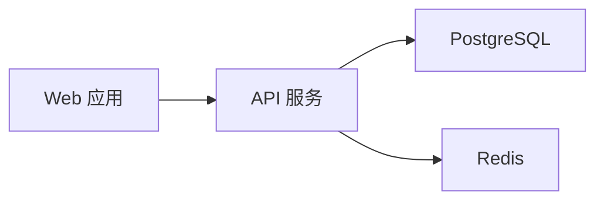

# Mermaid input, qv drawing

Write standard Mermaid source, not another node/edge JSON structure. qv parses it with Mermaid 11.12.0 and draws supported architecture diagrams with its own layout, HTML nodes, Lucide icons and SVG curves. It does **not** display a restyled Mermaid SVG for enhanced diagrams. Requires jsDelivr access; no npm installation.

## Input

Prefer a UTF-8 `.mmd` file:



Run `python3 <skill-dir>/scripts/render.py mermaid <diagram.mmd> <output-directory>/<title>.html`.

Optional title and tooltip text use this envelope; the graph still comes entirely from Mermaid:

```json
{
  "title": "内容平台",
  "source": "flowchart LR\n  web[Web 应用] --> api[API 服务]\n  api --> db[PostgreSQL]\n  api --> cache[Redis]",
  "descriptions": {
    "api": "统一校验身份并处理业务请求。"
  }
}
```

`source`: required, at most 50,000 characters. `title`: optional, at most 200 characters. `descriptions`: optional plain text keyed by exact node ID, at most 2,000 characters each. Omit descriptions when labels suffice. `icons`: optional `"auto"` (default) or `"none"`; applies to the whole enhanced diagram. `legend`: optional labels such as `{"solid":"同步调用","dotted":"异步事件"}`, only when those meanings are known. When authoring a diagram, use solid edges by default. Introduce distinct line styles only for distinct relationship meanings, and always explain every used style with semantic legend labels or explicit edge labels. Never author mixed styles and silently omit their explanation. For supplied source with unclear meaning, resolve it from context or ask rather than guess. The renderer does not invent business semantics from line style. No permanent description panel; tooltips appear on hover or keyboard focus. Unknown description IDs are reported.

## Current architecture scope

- `flowchart` / `graph` with short rectangular or rounded-rectangular node labels and ordinary point/open arrowheads. Solid, dotted and thick edges and edge labels are preserved.
- Ungrouped DAGs derive layers from connections. `LR`/`RL` use columns; `TB`/`BT` use rows. Narrow widths scroll only the drawing horizontally, preserving peer rows, readable nodes and routing; title and legend stay in place. Loading uses the shared whole-region dot-field loading animation (`assets/chart-loading.html`), not diagram-shaped placeholders or visible status prose.
- Flat, complete `TB`/`BT` `subgraph` groups define architecture layers in declaration order; captions and quiet rules replace large group boxes. Return connections between adjacent layers remain supported. Self-loops, same-layer and multi-layer skips currently fall back natively instead of drawing misleading routes.
- Prefer useful Lucide icons when every node has a recognized role (client, gateway, service, storage, queue, etc.). Icons are all-or-none: one unknown role hides icons for the whole diagram; `icons: "none"` explicitly disables them. Never fill gaps with generic decorative icons or mix icon and text-only nodes. No agent-authored icon paths.
- Node height 48px, regular desktop width at most 160px; 32px top/title spacing. Curves share per-side ports by direction; when a side has both incoming and outgoing connections, their ports sit 7px either side of center (14px apart); 1px neutral strokes and 5px integrated arrowheads. Entry grows nodes in 240ms, staggers layers by 220ms, traces lines in 650ms and reveals arrowheads in 50ms. Viewport re-entry replays without rebuilding; reduced motion disables animation.
- Nested/partial/overlapping groups, unsupported node shapes or arrowheads, custom source styles and unsupported routing cases keep **native Mermaid output with a visible reason**. Do not call this qv styling or silently discard syntax. Other diagram types use the same explicit native fallback.

This first adapter preserves the approved architecture design; it is not full custom rendering for every Mermaid flowchart construct. Keep labels concise and split very large diagrams into meaningful views. Never remove relationships merely to make a diagram fit.

## Validation and maintenance

The runner checks the envelope and generated fragment. It reports `runtime: pending-browser`; Mermaid syntax is checked at runtime. `data-state` becomes `enhanced`, `native` or `error`; `data-renderer="qv-architecture"` identifies genuine qv drawing.

`assets/mermaid-model.js` is the sole version-specific parser adapter. Mermaid's public `parse()` only identifies/validates the diagram; it does not return a general AST. The pinned adapter therefore uses `mermaidAPI.getDiagramFromText()` and flowchart DB accessors. These are internal/version-sensitive interfaces: never upgrade Mermaid without rerunning parser fixtures and visual comparison against the approved design. Do not replace this adapter with regex parsing or reconstruct edge identity from SVG geometry.

`assets/mermaid.html` owns qv layout, marks, interaction and motion. Native `render()` is used only for explicit fallback. Validation must cover appearance, shared ports, marker joins, tooltip proximity and actual animation—not only element counts. See `tests/mermaid-browser.md`.
