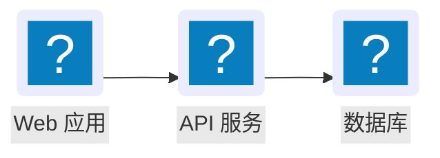

# Mermaid input and routing

使用标准Mermaid源码，渲染器解析并绘制受支持语义；输入仍是一份图，不另写节点坐标或连接JSON。需要可访问的CDN，固定解析版本为Mermaid 11.12.0。

## Input

优先写UTF-8 `.mmd`文件，调用方式沿用[技能入口](../SKILL.md#execute)。需要独立标题、说明或图标策略时使用JSON：

```json
{
  "title": "审核流程",
  "source": "flowchart LR\n draft[草稿] --> review{通过?}\n review --> done[完成]",
  "descriptions": {"review": "按已约定的验收标准复核。"}
}
```

- `source`必填，最多50,000字符；`title`可选，最多200字符。图源支持的标题及frontmatter会按图型读取；独立标题优先。
- `descriptions`按精确节点或分组ID提供普通文本，每项最多2,000字符；标签已足够时省略。未知ID会被报告；各图型不支持的额外说明走明确回退。
- `icons`为`auto`（默认）、`required`或`none`。新建架构图为每个服务声明真实语义图标；显式源图标始终保留，junction不需要服务图标。缺失必需图标时修正明确报告的服务。
- `legend`只接受`solid`／`dotted`的真实业务含义。不同线型对应不同语义，并以图例或边标签说明；来源含义不明确时先从上下文确认。
- 分组表达语义包含。Flowchart与Architecture始终完整展示分组及连接；State保留自己的复合状态导航。旧`navigation`字段兼容接收但不影响输出，新spec省略它。

## Type reference

先读[共享呈现](charts.md)，再只读下表中当前图型的小节。每个小节拥有该图型的支持范围、语义、布局和交互。

| 源图型 | 专用规则 |
| --- | --- |
| `flowchart` / `graph` / `architecture-beta` | [Flowchart与Architecture](mermaid-graphs.md#flowchart-与-architecture) |
| `stateDiagram-v2` | [State](mermaid-graphs.md#state) |
| `erDiagram` | [ER](mermaid-graphs.md#er) |
| `classDiagram` | [Class](mermaid-graphs.md#class) |
| `block-beta` | [Block](mermaid-graphs.md#block) |
| C4 | [C4](mermaid-graphs.md#c4) |
| `mindmap` | [Mindmap](mermaid-graphs.md#mindmap) |
| `gitGraph` | [Git](mermaid-graphs.md#git) |
| `sequenceDiagram` | [Sequence](mermaid-process.md#sequence) |
| `timeline` | [Timeline](mermaid-process.md#timeline) |
| `journey` | [Journey](mermaid-process.md#journey) |
| `kanban` | [Kanban](mermaid-process.md#kanban) |
| `gantt` | [Gantt](mermaid-process.md#gantt) |
| `pie` | [Pie](mermaid-data.md#pie) |
| `xychart-beta` | [XY](mermaid-data.md#xy) |
| `radar-beta` | [Radar](mermaid-data.md#radar) |
| `sankey-beta` | [Sankey](mermaid-data.md#sankey) |
| `quadrantChart` | [Quadrant](mermaid-data.md#quadrant) |

## Icons

中文架构名称优先使用flowchart的标准图标声明，图标来自宿主已有Lucide：



Architecture内建cloud/database/disk/internet/server确定映射到Lucide；Mermaid 11.12的architecture名称语法有限制，使用其合法文本。服务图标表达对象语义。

## Presentation

引用包含`mode="wide"`（默认ASCII）或`"mode":"wide"`（显式旧格式），原样输出runner返回的引用。增强图内联保留可读字号，只滚动绘图区；展开适配完整当前图，返回恢复内联滚动。Gantt按1:1内容高度展开，超出窗口时滚动。Pie/Radar预设沿用自身响应式绘制。State在两种模式保留当前层级。

增强图由qv自行绘制；未支持语法明确显示原因并回退Mermaid原生。自定义样式、富文本或未知语义保留真实关系；原生也不能解析时显示错误。原生回退不接入增强viewport。原生Copy as image是当前可见预览截图，独立高分辨率导出不在此契约内。
